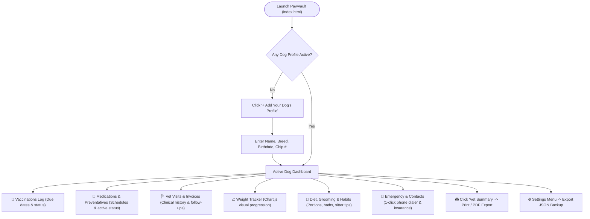

# 🐾 PawVault — Complete Application Walkthrough & User Guide

Welcome to **PawVault**, your private canine medical and care record companion. This walkthrough guides you through every screen and feature of the application.

---

## 🗺️ System Workflow Overview

---

## 🚀 Step 1: Launching the Application

You can open the app in two ways:

1. **Direct File Launch (Easiest)**:
   - Navigate to: `dog-health-vault/index.html`
   - Double-click `index.html` to open in Chrome, Edge, Brave, or Firefox.
2. **Online via GitHub Pages** (if enabled in your repository):
   - Open your GitHub repo: [github.com/rsanthoshkumar376-ux/dog-health-vault](https://github.com/rsanthoshkumar376-ux/dog-health-vault)
   - Go to **Settings > Pages > Branch: `main` > Save** to access it anytime from your smartphone.

---

## 🐶 Step 2: Adding Your Dog's Profile

When you first open the app, you will see the **"Welcome to Your Dog's Health Vault"** welcome banner.

1. Click the green/amber **"+ Add Your Dog's Profile"** button (or **"Add Dog"** in the top navigation).
2. Fill out your dog's core vitals:
   - **Name**: e.g. *Bruno*, *Milo*, *Bella*
   - **Breed**: e.g. *Labrador Retriever*, *German Shepherd*, *Beagle*
   - **Birthdate**: The app automatically computes their exact age in years and months.
   - **Gender / Status**: *Male (Neutered)*, *Female (Spayed)*, etc.
   - **Microchip ID**: 15-digit RFID tag number (found on adoption/vet papers).
   - **Rabies Tag #**: City or county license badge number.
   - **Known Allergies**: Enter any sensitivities separated by commas (e.g. *Chicken protein*, *Dust mites*).
3. Click **"Save Profile"**.
4. **Add a Photo**: Hover over the profile image box in the top-left card and click the camera icon to upload a photo of your dog.

> [!TIP]
> You can add multiple dogs! Use the dropdown selector in the top bar to switch between dogs at any time.

---

## 💉 Step 3: Tracking Vaccinations & Renewal Dates

Under the **Vaccinations** tab:
1. Click **"Log Vaccination"**.
2. Enter the vaccine name (e.g., *Rabies (3-Year)*, *DHPP / 5-in-1*, *Bordetella*, *Leptospirosis*).
3. Set the **Date Administered** and the **Next Due Date**.
4. Optional: Add the **Batch / Lot #** and administering **Clinic Name**.
5. Click **"Save Vaccine"**.

### How Automated Alerts Work:
- **Up to Date (Green)**: Renewal date is more than 30 days away.
- **Due Soon (Amber)**: Renewal date is within the next 30 days. An alert will appear in the top banner.
- **Overdue (Red)**: Renewal date has passed. A prominent danger warning appears to remind you to book a vet visit.

---

## 💊 Step 4: Managing Medications & Preventatives

Under the **Medications & Preventatives** tab:
1. Click **"Add Medication / Preventative"**.
2. Record routine preventatives:
   - **Flea & Tick / Heartworm**: e.g. *Simparica Trio*, *NexGard*, *Heartgard*, *Bravecto*.
   - **Prescription Rx**: e.g. *Carprofen*, *Apoquel*, *Amoxicillin*.
   - **Supplements**: e.g. *Fish Oil (Omega-3)*, *Glucosamine Joint Chews*.
3. Specify **Dosage** (e.g., *1 chewable tablet*) and **Frequency** (e.g., *Monthly on the 1st*).
4. Set the **Next Dose Due** date.
5. If a prescription ends, click **"Mark Inactive"** to archive it into past history without deleting the medical record.

---

## 🩺 Step 5: Recording Vet Visits & Medical History

Under the **Vet Visits & History** tab:
1. Click **"Log Vet Visit"**.
2. Fill in:
   - **Visit Date** & **Reason** (e.g. *Annual Checkup*, *Ear infection*, *Teeth scaling*).
   - **Clinic / Doctor Name**.
   - **Cost / Invoice ($)** for budget and insurance tracking.
   - **Doctor's Diagnosis & Notes**: Summary of findings, lab tests, and prescriptions.
   - **Recommended Follow-up**: When the vet wants to see your dog next.
3. Every visit is arranged in a reverse-chronological timeline.

---

## 📈 Step 6: Logging Weight & Monitoring the Growth Curve

Under the **Weight & Growth Tracker** tab:
1. Use the right-hand form to enter your dog's latest weight in either **kg** or **lbs** and select the date.
2. Click **"Save Entry"**.
3. The interactive **Chart.js curve** automatically updates, displaying the weight trend line so you can ensure your dog stays at a healthy weight.

---

## 🥣 Step 7: Diet, Nutrition & Grooming Habits

Under the **Diet, Habits & Care** tab:
1. Click **"Edit"** on the Feeding Routine card to customize:
   - **Food Brand & Formula**: Exact brand, dry kibble, or wet food.
   - **Portion Size**: Cups or grams per meal.
   - **Feeding Schedule**: Exact times (e.g., *7:30 AM & 6:30 PM*).
   - **Approved Treats**: Healthy treats allowed.
2. Click **"Edit"** on the Grooming card to log bath frequency, nail trims, dental brushing routine, and behavioral notes (e.g. fear of storms, leash etiquette).

---

## 🚨 Step 8: Emergency Directory & 1-Click Dialing

Under the **Contacts & Insurance** tab:
1. Click **"Update Contacts & Insurance"**.
2. Add your **Primary Vet's** name, phone number, and address.
3. Add the nearest **24/7 Emergency Animal Hospital** phone and location.
4. Add your **Pet Insurance Policy** provider and policy number.
5. In an emergency, simply tap **"Call Primary Vet"** or **"Call Emergency Hospital"** on your phone to dial immediately. Direct access to the 24/7 **ASPCA Poison Control hotline `(888) 426-4435`** is also built-in.

---

## 🖨️ Step 9: Printing the Vet & Dog-Sitter Summary

Whenever you visit a new vet, board your dog, or leave them with a sitter:
1. Click the **"Vet Summary"** button in the top navigation bar.
2. PawVault generates a clean, single-page **Canine Medical & Care Dossier** containing:
   - Full identification, photo, microchip, and rabies license.
   - Medical warnings, allergies, and behavioral tips.
   - Complete vaccination dates and batch numbers.
   - Active medications and feeding schedule.
   - Emergency contacts and insurance info.
3. Your browser's print dialog will open to print to paper or save as a **PDF**.

---

## 💾 Step 10: Backing Up Your Data

All data is stored directly in your browser's private local storage.
- Click the **Gear icon (⚙️)** in the top right.
- Click **"Export Backup (JSON)"** to download a `.json` backup file to your computer.
- You can restore your data on any device or browser by clicking **"Import Data"** and choosing your backup file.
